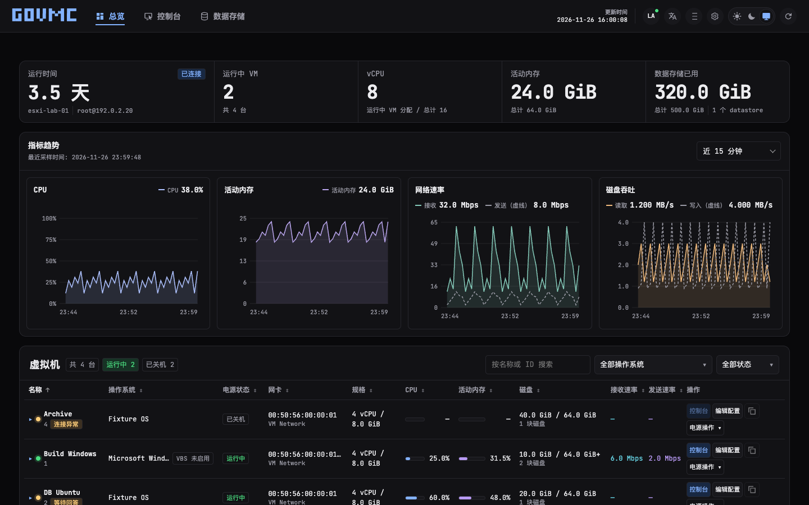
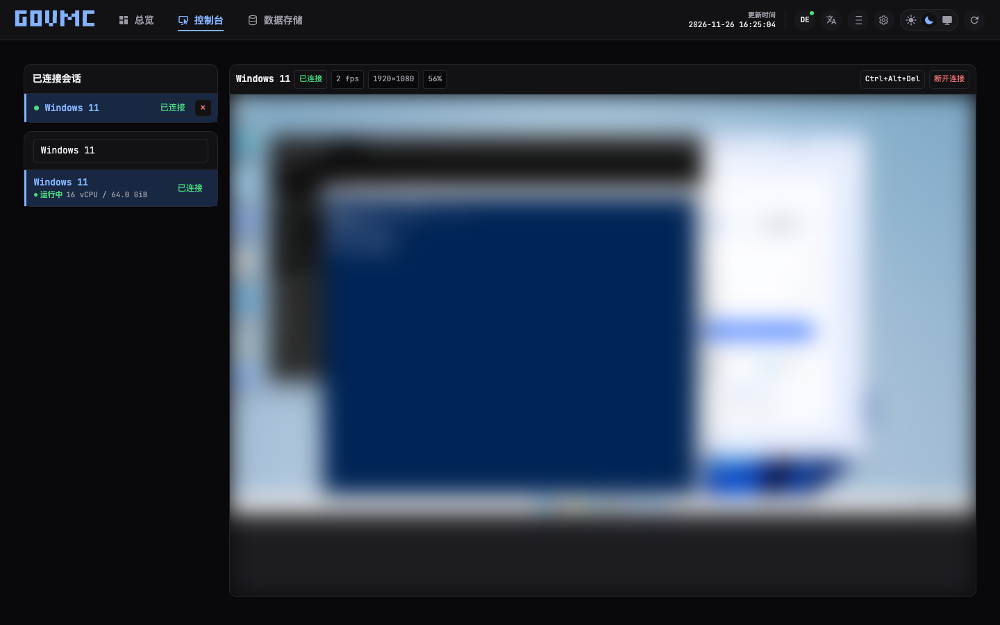
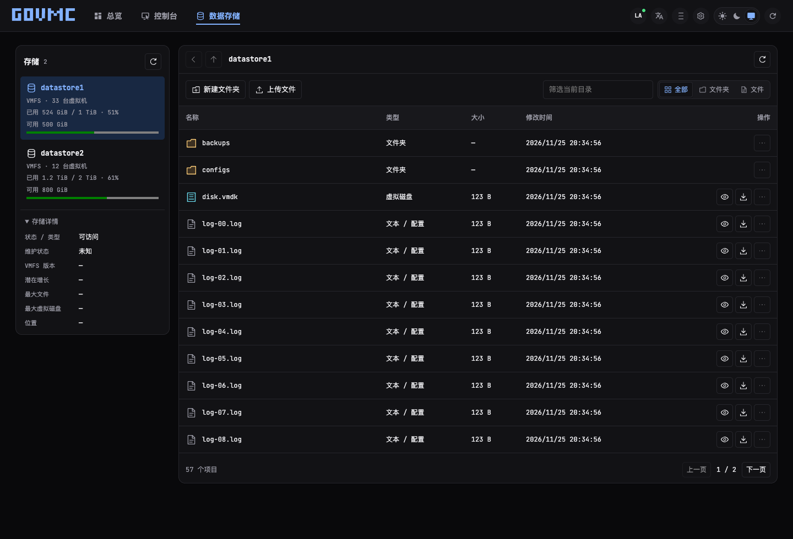
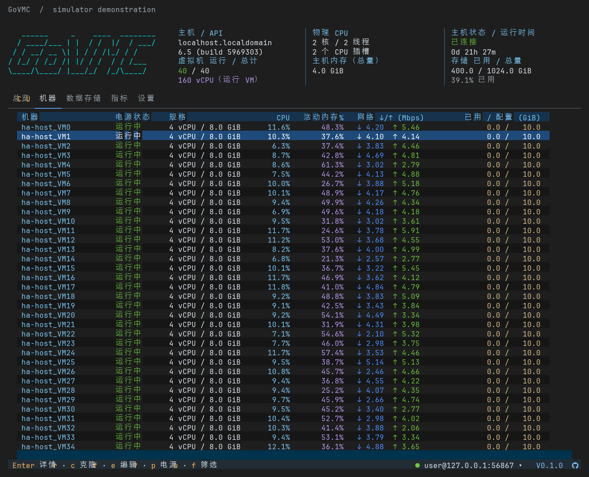
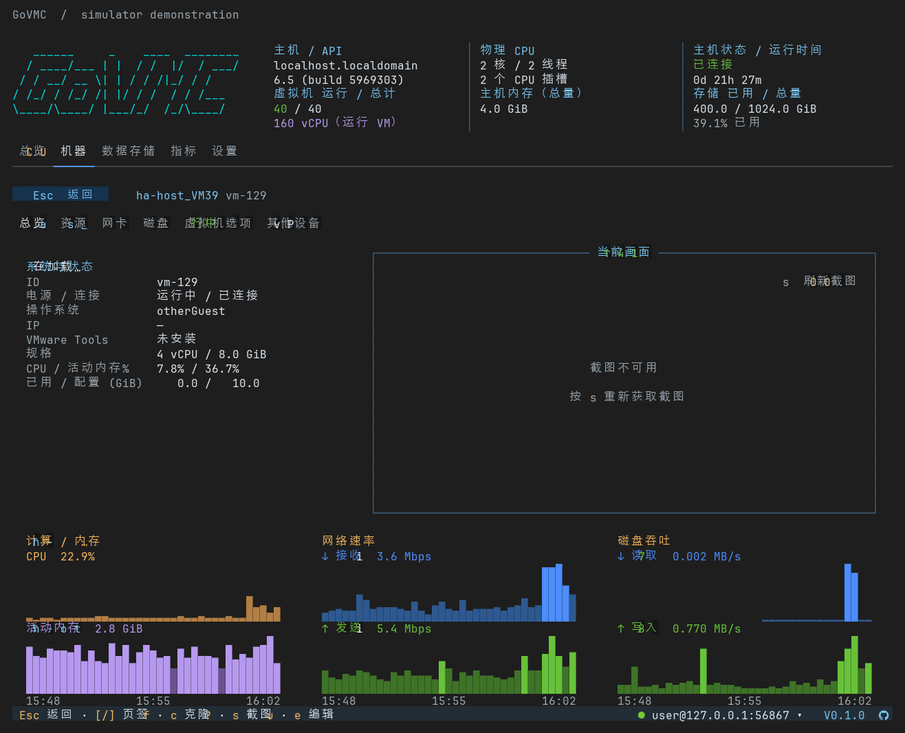
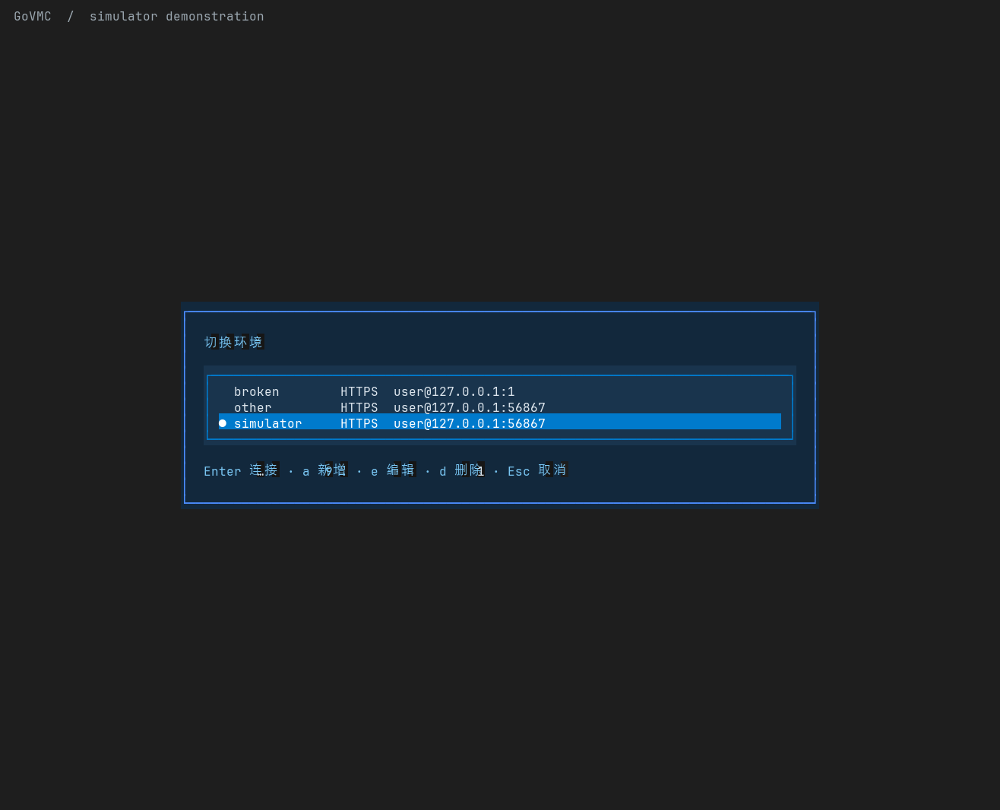

# GoVMC

**English** | [简体中文](README.zh.md)

[](https://go.dev/)
[](https://github.com/Necho-dev/govmc-cli/actions/workflows/test.yml)
[](https://github.com/Necho-dev/govmc-cli/releases)
[](https://pypi.org/project/govmc-cli/)
[](LICENSE)
[](https://github.com/Necho-dev/govmc-cli)

ESXi management through a native Go **CLI**, full-screen **TUI**, **stdio MCP**, and **Web workspace**. All entry points share inventory services, configuration, task history, and operation audits. The executable is `govmc`; the Go module is `github.com/Necho-dev/govmc-cli`. The Python distribution is also `govmc-cli`.

Standalone ESXi is the primary acceptance target. vCenter support remains constrained by the default datacenter/host selection; this is not a complete vCenter orchestration product.

<p align="center">
  
</p>

<table>
  <tr>
    <td align="center" valign="top" width="33%"><strong>Web · Overview</strong><br></td>
    <td align="center" valign="top" width="33%"><strong>Web · Console</strong><br></td>
    <td align="center" valign="top" width="33%"><strong>Web · Datastores</strong><br></td>
  </tr>
  <tr>
    <td align="center" valign="top" width="33%"><strong>TUI · Machines</strong><br></td>
    <td align="center" valign="top" width="33%"><strong>TUI · Details</strong><br></td>
    <td align="center" valign="top" width="33%"><strong>TUI · Profiles</strong><br></td>
  </tr>
</table>

The animation shows CLI commands; screenshots show the Web and terminal workbenches. Public media excludes credentials and environment addresses. WMKS SDK files are installed separately and are not included.

## Features

- **Machines and metrics** — host/VM inventory, power operations, hardware details, screenshots, and sampled CPU, memory, network, and disk throughput.
- **Configuration** — CPU/memory, supported VM options, disk expansion/addition, and NIC editing/addition through CLI/TUI/Web. Online changes depend on the host, controllers, snapshots, and hot-add settings; disks can only grow.
- **Clone and transfer workflows** — preview and confirmation, same-host cross-datastore targets, persistent tasks, progress, and cancellation requests across CLI/TUI/Web/MCP.
- **Profiles** — saved encrypted credentials, temporary target selection, and renaming without losing access to historical tasks, logs, or audits.
- **Agent access** — one stdio MCP implementation, default read-only permissions, structured JSON, and an offline bundled Skill supporting both CLI and MCP.
- **Web workspace** — machine overview, interactive consoles, datastore browser, task drawer, settings, five appearance choices, and per-environment IndexedDB caching.
- **Local observability** — readable terminal output, original structured JSONL logs, SQLite audits, and profile-aware queries.
- **Shared translations** — CLI/TUI/Web use the same per-language JSON dictionaries in `web/locales/`.

## Quick start

Build from this checkout with Go 1.25 or newer:

```sh
make build
./bin/govmc --help
./bin/govmc profiles add lab --url https://esxi.example:443/sdk --username root
./bin/govmc profiles use lab
./bin/govmc doctor
./bin/govmc vm list --json
./bin/govmc --profile lab tui
```

Profile creation prompts for the password without echoing it. New profiles verify TLS by default; `--insecure` is an explicit opt-in for hosts requiring it. Commands below assume `govmc` is on `PATH` (`make install` installs with Go).

## Installation and distribution

The package/repository name is **`govmc-cli`**; the installed command is **`govmc`**. The first release is `0.1.0`. Install from PyPI, GitHub release artifacts, or build from source as shown below.

### Python: pipx or pip

Requires Python **3.9+** and a supported platform wheel. The wheel bundles the Go executable: installation does **not** need a Go compiler.

```sh
# Recommended isolated CLI installation (requires pipx):
pipx install govmc-cli

# Alternatively, install into a Python virtual environment:
python3 -m venv .venv
# macOS / Linux:
. .venv/bin/activate
# Windows PowerShell instead: .venv\Scripts\Activate.ps1
python -m pip install --upgrade pip
python -m pip install govmc-cli
govmc --version
```

Pin a release with `python -m pip install govmc-cli==0.1.0`; upgrade with `pipx upgrade govmc-cli` or `python -m pip install --upgrade govmc-cli`.

### Go: install or build

Requires Go **1.25+** to compile. A prebuilt binary from [GitHub Releases](https://github.com/Necho-dev/govmc-cli/releases) requires neither Go nor Python: unpack the matching ZIP and place `govmc` (`govmc.exe` on Windows) on `PATH`.

```sh
# Build/install a published version into $(go env GOPATH)/bin:
go install github.com/Necho-dev/govmc-cli/cmd/govmc@v0.1.0
# Or track the latest published release:
go install github.com/Necho-dev/govmc-cli/cmd/govmc@latest

# Build from source:
git clone https://github.com/Necho-dev/govmc-cli.git
cd govmc-cli
make build
./bin/govmc --version
# Install the checkout with: make install
```

Add `$(go env GOPATH)/bin` (or your `GOBIN`) to `PATH` if the `govmc` command is not found. Source builds need the Go toolchain; Python is needed only for the optional ZIP/wheel packaging helpers.

### Use the same command after either installation

```sh
govmc profiles add lab --url https://esxi.example:443/sdk --username root
govmc profiles use lab
govmc doctor
govmc vm list
govmc tui
govmc serve --listen 127.0.0.1:8765
# Agent setup:
govmc skill install --client codex
govmc mcp json --client codex
```

Profile creation prompts for the password. CLI, TUI, stdio MCP, the bundled Skill and ordinary Web work through either installation method. Only the interactive Web console needs the separately installed VMware WMKS SDK; no `[web]` extra is required.

### Complete Web setup without WMKS

`serve` still needs a valid, reachable ESXi profile. Only the interactive browser console needs the optional SDK; Overview, metrics, screenshots, configuration, storage, tasks, and CLI/MCP/TUI do not. New installations need no `.env` file.

```sh
# Create the profile once; the password is prompted without echo and encrypted.
govmc profiles add lab --url https://esxi.example:443/sdk --username root
govmc profiles use lab
govmc --profile lab doctor --json

# A clean configuration reports state=missing. This does not block ordinary Web.
govmc wmks status --json
govmc --profile lab serve --listen 127.0.0.1:8765
```

Open <http://127.0.0.1:8765>. Console navigation remains visible and shows installation guidance without requesting a ticket. TLS verification is enabled by default; use `--insecure` only when explicitly needed for the ESXi certificate.

### Install, activate, repair, and uninstall WMKS

Obtain an SDK ZIP you are entitled to use from the [official HTML Console SDK page](https://developer.broadcom.com/sdks/vmware-html-console-sdk/latest/). The page currently lists 2.2.1. GoVMC does not download it, accept terms on your behalf, or authenticate its publisher. ZIP and file SHA-256 values detect content changes, not vendor identity.

Official download steps:

1. Open [VMware HTML Console SDK](https://developer.broadcom.com/sdks/vmware-html-console-sdk/latest/) and click **Download** under **Downloads** for `WebMKS_SDK_2.2.1.zip`. The website generates a temporary signed URL, so use the page button.
2. Keep the original ZIP unchanged; no extraction, rearrangement, or repackaging is needed. Transfer it to the machine running `serve` if necessary.
3. Check the downloaded bytes. The tested official package has SHA-256 `fa0e8b0cf8f41a3c8d03626d848ab372e1b5e1177066add7124547095c278746`. On macOS, run `shasum -a 256 ~/Downloads/WebMKS_SDK_2.2.1.zip`; use `sha256sum` on Linux or `Get-FileHash -Algorithm SHA256` in PowerShell. Recheck the source if the vendor changes its package; this digest is not for other versions.

The default installation is `~/.govmc/wmks/`. YAML `wmks.directory` overrides it. With a custom configuration, use the same `--config` for installation and serve. `--wmks` overrides only the running serve process, not the installation destination.

In another terminal **on the host running serve**, with the same user and configuration directory:

```sh
govmc wmks install --file ~/Downloads/WebMKS_SDK_2.2.1.zip --dry-run --json
govmc wmks install --file ~/Downloads/WebMKS_SDK_2.2.1.zip --yes
govmc wmks status --json
govmc wmks verify --json
```

Review the preview before submitting. In an interactive terminal, omit `--yes` to confirm after preview; noninteractive changes require it. Installing/updating can run while serve is active, but the existing process keeps its old snapshot. CLI `state=ready` reports the files on disk, not adoption by every running process.

Stop the old serve with Ctrl+C, restart it with the **same** profile/configuration, then refresh the page or click **Check again**:

```sh
govmc --profile lab serve --listen 127.0.0.1:8765
```

When the component is ready, select a powered-on machine. Canvas initialization precedes ticket acquisition; ESXi permissions and WSS connectivity are still required. A component loading error is distinct from an ESXi login or ticket error. Restarting serve disconnects Web sessions; virtual machines keep running.

To uninstall, stop serve processes using the current SDK first:

```sh
govmc wmks uninstall --yes
govmc wmks status --json
# Start again: ordinary Web works and Console returns to the installation guide.
govmc --profile lab serve --listen 127.0.0.1:8765
```

`wmks_in_use` means a process still holds the current SDK. `verify` returns a nonzero exit status for missing/corrupt SDKs; `status` returns `missing` successfully when none is installed and reports an error for invalid state. If verification fails, stop the relevant serve, uninstall, reinstall a valid ZIP, verify, and restart. Reinstalling identical bytes does not overwrite a corrupt immutable directory; uninstall it first. Preserve malformed state metadata for diagnosis rather than editing encrypted profile data.

Console sessions and reloads: leaving Console for Overview with active sessions requires confirmation, including the logo, mobile navigation, and browser Back/Forward. Confirmed in-page navigation retains background connections; cancellation preserves the current display. Refresh/close uses the browser's native warning; document navigation to Settings/Datastores uses a workbench-wide confirmation. Leaving does not power off machines. The current tab stores only machine identities and selection in sessionStorage, scoped to the server instance/profile (up to six machines, twelve hours). Reloading or returning validates fresh inventory and obtains new tickets to recover the display, without storing tickets or automatically capturing input. Manually disconnected sessions and powered-off, removed, or identity-changed machines are not reconnected; switching environments clears old recovery records. Browsers may require prior user interaction to show native warnings and control their wording/style. The header refresh button updates data without recreating console connections.

### Accepted SDK ZIP layout and limits

The ZIP must contain exactly **one** file named `wmks.min.js`. These four **nonempty**, case-sensitive paths must share its SDK root:

```text
SDK.zip
└── optional/outer/directory/
    ├── wmks.min.js
    ├── css/wmks-all.css
    └── img/
        ├── touch_sprite.png
        └── touch_sprite_feedback.png
```

An SDK directly at the ZIP root also works. Multiple copies, including copies in samples/backups, are rejected as ambiguous. Keep all upstream license/notice files. No GoVMC `plugin.json`, GoVMC source/binary, wheel, or separately bundled jQuery is required. Archive naming/extension does not determine validity: the contents must be ZIP data with the required SDK layout, not a single JS file or a ZIP containing only another ZIP.

| Validation | Requirement |
| --- | --- |
| Archive bytes | At most 32 MiB |
| Per-file expanded size | At most 16 MiB |
| Total actual expanded size | At most 128 MiB, including files not installed |
| Entry count | At most 1,024 files and directory entries combined |
| Paths | Relative, at most 512 bytes; no `..`, absolute/drive/UNC paths, backslashes, control characters, Windows reserved names, or trailing dots/spaces |
| Duplicates / file types | No duplicates differing only in case; no symbolic links or special files |
| Encoding | Unencrypted ZIP with methods supported by Go's ZIP reader (ordinary Store/Deflate); no password/encryption support |

The installer retains `wmks.min.js`, `css/`, `img/`, and files whose names contain `license` or `notice`. It does not execute archive contents. JavaScript marker checks and later file checksums are structural/integrity checks, **not** a guarantee of SDK/browser/ESXi compatibility. An unverified SDK version is displayed as `unidentified`; the browser must still initialize successfully.


Official-package acceptance: `WebMKS_SDK_2.2.1.zip` (378,058 bytes), downloaded from the [official Downloads section](https://developer.broadcom.com/sdks/vmware-html-console-sdk/latest/), passed preview, installation, verification, status and uninstallation in an isolated configuration. Its MD5 matched the published `b3d69d9422fb3725d96d322c6c29bd16`. SHA-256: `fa0e8b0cf8f41a3c8d03626d848ab372e1b5e1177066add7124547095c278746`. Download URLs are generated by the website; use its Download button rather than saving an expiring URL. Package installation and a live-ESXi Web console session have both been verified; verify your own ESXi/browser combination after deployment.

### Configuration and runtime locations

```text
~/.govmc/
  config.yaml                    # Saved profiles/preferences; generated by CLI/TUI
  config.key                     # Credential key: keep with the configuration
  data.db                        # Tasks and audits
  logs/                          # Runtime JSONL
  wmks/
    state.json                   # Active SDK digest; no Profile password
    sdk/<content-digest>/        # Runtime resources, notices, and receipt.json
    .locks/                      # Installation and in-use locks
```

Configure the SDK directory in `config.yaml`:

```yaml
wmks:
  directory: ./wmks
```

Relative paths resolve against the configuration file's directory; the default is its `wmks/` subdirectory. CLI/TUI/MCP/serve share this configuration without requiring environment variables.

Override it for a single process without modifying YAML:

```sh
govmc serve --wmks /path/to/sdk
```

Precedence: `--wmks` → `wmks.directory` → default. Relative `--wmks` paths resolve against the working directory. Both managed installations and extracted directories directly containing `wmks.min.js`, `css/`, and `img/` are supported. Extracted SDKs load read-only. Failed validation disables only the browser console; ordinary Web remains available. Manage installed SDKs with `govmc wmks` using the corresponding YAML configuration.

SDK state is application-wide for that configuration directory; `--profile` selects ESXi, not a separate SDK installation. A browser client's computer is not the installation target unless it also runs serve. An explicitly selected configuration must be used consistently:

```sh
govmc --config /srv/govmc/config.yaml profiles add lab --url https://esxi.example:443/sdk --username root
govmc --config /srv/govmc/config.yaml wmks install --file /path/to/SDK.zip --yes
govmc --config /srv/govmc/config.yaml wmks verify --json
govmc --config /srv/govmc/config.yaml --profile lab serve --listen 127.0.0.1:8765
```

The example directory `/srv/govmc` must be readable/writable by the serve user; choose a suitable local directory. PowerShell uses the same `--config` argument. Normal use needs no override. Do not copy passwords or SDK contents into YAML manually. Only the current SDK digest is removed by uninstall; older update caches are not automatically enabled or purged. See the [bundled WMKS reference](skills/govmc/references/web_console.md) for troubleshooting.


## Profiles and credentials

The default configuration is `~/.govmc/config.yaml`; `--config /path/config.yaml` selects another file. Environment variables and `.env` files are not required for normal use.

```sh
govmc profiles list
govmc profiles current
govmc profiles update lab
govmc profiles rename lab staging
govmc profiles use staging
govmc --profile production vm list --json
```

`--profile` overrides the target for one command without changing the saved default. CLI/TUI support adding, editing, renaming, and deleting profiles; destructive profile changes require confirmation. TUI forms offer **Save** and **Save and Connect**. Web only switches between saved profiles, with confirmation, independently per browser tab; it does not add, edit, or delete profiles.

Passwords use AES-256-GCM. Private files use mode `0600` on Unix; Windows uses a protected ACL restricted to the current user, SYSTEM and administrators. The separate `config.key` lives beside the configuration; both files use the platform-specific access restrictions above. Back up both files together. This protects against disclosure of the configuration alone, not an attacker able to read both files or act as the local user. For automation, use `--password-stdin` with an existing credential manager rather than putting a password in command arguments. `profiles list/show/current` omit credentials.

Profiles have stable identities. After `profiles rename OLD NEW` or a TUI rename, querying the new name includes its previous task/log/audit history. Details retain `originalProfile`; raw records and JSONL are not rewritten. Reusing the old name for another profile does not merge the two histories.

Existing legacy `govmc/profiles.json` configurations can migrate on first use; missing legacy credentials must be saved again. Compatibility environment overrides remain available, but new setups should use profiles.

## Command overview

| Purpose | CLI entry |
| --- | --- |
| Connection checks | `govmc doctor` |
| Host / machines | `govmc host info`, `govmc vm list`, `govmc vm info VM` |
| Metrics | `govmc metrics counters`, `govmc metrics host`, `govmc metrics vm VM` |
| Hardware changes | `govmc vm edit VM --file changes.json` |
| Screenshot | `govmc vm screenshot VM --out /tmp/screenshot.png` |
| Console input | `govmc vm console input VM --actions actions.json --dry-run` |
| Storage / browsing | `govmc datastore list`, `govmc datastore files DATASTORE PATH` |
| Persistent tasks | `govmc tasks list`, `govmc tasks status TASK_ID`, `govmc tasks cancel TASK_ID` |
| Runtime logs / audits | `govmc logs`, `govmc audits` |

Use each command's `--help` for flags and `--json` for structured results. VM changes accept a JSON file or `--file -`; supported fields and online-change restrictions are described in the [VM configuration reference](skills/govmc/references/hot_expand.md).

### Cloning and file transfers

```sh
# Preview only: no execution task or resource modification.
govmc --profile lab vm clone BASE CHILD --dst-datastore datastore2 --dry-run --json
govmc --profile lab datastore copy datastore1 source.iso copies/source.iso --dst-datastore datastore2 --dry-run --json

# Submit only after reviewing the plan; --yes is explicit confirmation.
govmc --profile lab vm clone BASE CHILD --dst-datastore datastore2 --yes --json
govmc --profile lab tasks list --json
govmc --profile lab tasks status TASK_ID --watch --timeout 10m
```

The clone source must be powered off and connected. By default, the clone inherits the supported source hardware configuration and disk provisioning type, receives a new VM identity, and stays powered off. Guest hostnames, static IPs, and application IDs still need separate customization. Unsupported disk/snapshot/encryption/vTPM arrangements fail preflight rather than silently producing an incomplete clone.

`datastore move` follows the same preview/confirmation model as `copy`. Cross-datastore operations are within one ESXi environment; cross-host/profile migration is not provided. Clone/copy/move create durable tasks in `data.db`; ordinary reads and dry-runs do not create execution tasks. All four surfaces query that same local task store, provided they use the same configuration directory. Cancellation is a request, not rollback; interrupted workflows are not automatically replayed. See the [bundled clone workflow](skills/govmc/references/clone_workflow.md).

### Remote control

CLI and stdio MCP acquire a WebMKS ticket and connect directly to ESXi without requiring `serve`. `vm console input` supports bounded keyboard, pointer, and wait actions; `--dry-run` sends no input. MCP offers `esxi_vm_console_input`, `esxi_vm_console_press_key`, `esxi_vm_console_type_text`, and `esxi_vm_console_pointer`.

Input does not require VMware Tools, but depends on guest focus and keyboard layout. A successful send is not proof of guest program completion: capture a fresh screenshot to verify the result. Web provides interactive keyboard/mouse consoles; TUI currently provides screenshots, not an interactive console. GuestOperations execution is a separate Tools-dependent MCP/REST capability. See [remote control](skills/govmc/references/remote_control.md).

## TUI

The footer follows OpenWrt CLI: `V0.1.1` and a GitHub link. Click the icon or press `G` to open the project. Use a Nerd Font for the GitHub glyph.

```sh
govmc --profile lab --language zh tui
```

Main tabs: **Overview / Machines / Datastores / Metrics / Settings**. Select a machine with `Enter`; `Esc` returns to the list while preserving its search, filters, and selection. Use `e` to edit, `p` for power actions, and `c` to clone a powered-off source. Details combine compact basic information, screenshots, and metric charts.

Settings contains **Language / MCP / Profiles / Tasks / Logs / Audits**. Use `[` / `]` for subpages and the on-screen shortcuts for filtering, refreshing, and actions. Datastore browsing distinguishes folders/files, restores parent-directory context, and provides copy/move previews and confirmation.

## Web workspace

```sh
# Ordinary Web is included; the console SDK is optional:
govmc --profile lab serve --listen 127.0.0.1:8765
# Explicit LAN listening; use this server's LAN IP from other devices:
govmc --profile lab serve --listen 0.0.0.0:8765
```

The default URL is <http://127.0.0.1:8765>. The startup message prints the address. `--web-dir` selects static assets, not profiles or data storage. Ordinary pages are embedded by default. Use `--web-dir` only to explicitly override the UI with matching assets, not to install an SDK.

Overview, Console, and Datastores share the header and environment selector. The task drawer supports status filters, details/back navigation, an active-task badge, manual refresh, and optional auto-refresh. Settings provides appearance/language, runtime logs, and audits. Magic Blue and Classic Dark are selected in Settings; the header retains its light/dark/system controls.

Overview refreshes while visible, normally every 20 seconds; metric timestamps represent ESXi sample times, not a synthetic live clock. Background tabs pause polling and refresh on return. Cached IndexedDB snapshots appear while fresh requests run; cached data does not authorize writes.

Local `serve` currently has **no login page or Cookie-based account authentication**. Optional `API_TOKEN` access control is retained; MCP mode does not restrict Web/REST operations. Listening on `0.0.0.0` exposes access to the selected environments to reachable clients under the configured access controls. Docker login, invitations, and account storage are not implemented deployment features.

## MCP and bundled Skill

```sh
govmc mcp json --client codex
govmc mcp serve
govmc mcp privilege --json
govmc skill show
govmc skill install --client codex
```

MCP uses **stdio only**; the client starts `govmc mcp serve` as a subprocess. stdout is reserved for JSON-RPC. The former HTTP `/mcp` endpoint and `--mcp-stdio` entry have been removed; REST remains available.

The default mode is `readonly`. Only CLI/TUI can change it; Web/MCP cannot raise privileges. Each call rereads configuration. Global mode is a ceiling, and profile mode can further restrict it:

```sh
govmc config set --mcp-mode readwrite
govmc profiles update production --mcp-mode readonly
govmc profiles update lab --mcp-mode inherit
govmc config set --mcp-mode readonly
```

Writes also require `confirm: true`. Clone/copy/move previews remain available in read-only mode. MCP tools accept a per-call `profile`, overriding the process default without changing `active`; `govmc --profile lab mcp serve` pins only the default. Local task/log/audit queries do not require an ESXi connection. Tool availability is not identical to every CLI command: for example, VM configuration editing is currently exposed through CLI/TUI/Web, not a general MCP edit tool.

The bundled `govmc` Skill installs offline and supports CLI and stdio MCP. Its entrypoint routes to task-specific references for setup, inventory, tasks/audits, datastores, cloning, VM configuration, remote control, WMKS and troubleshooting; load only the references needed for the current request. It explains selection, preview, confirmation, and verification; cloning itself is a shared Go workflow, not a Skill-only script. See the [Skill](skills/govmc/SKILL.md) for CLI/MCP workflows. The REST contract is available at `GET /v1/openapi.yaml` and in [openapi.yaml](internal/httpserver/openapi.yaml).

Install to `~/.agents/skills/govmc` (Codex), `~/.cursor/skills/govmc` (Cursor), or `~/.claude/skills/govmc` (Claude Code). After upgrading the executable, use `govmc skill install --client CLIENT --force` to replace an existing installation, preserving any local changes first. Older installations under a different Skill name are not removed automatically.

## Logs, audits, and language

All local state follows the selected configuration directory:

| File / directory | Purpose |
| --- | --- |
| `config.yaml` / `config.key` | Profiles, preferences, permissions / credential encryption key |
| `data.db` | SQLite operation audits and persistent tasks |
| `logs/` | Per-process original structured JSONL runtime logs |

Terminal logs use full timestamps and readable text; interactive terminals add restrained color. JSONL retains original structured fields. Default runtime retention is 7 days with a 50 MiB cleanup target; audits default to 90 days. Only allowlisted metadata is recorded, not passwords, tokens, or request/response bodies. Audits are not tamper-proof against the local administrator.

```sh
govmc logs --target lab --source serve --limit 50 --json
govmc audits --target lab --outcome failed --limit 50 --json
govmc config language zh
govmc --language en tui
```

TUI/Web settings and MCP `esxi_logs_list` / `esxi_audits_list` query the same sources. Translation sources are `web/locales/en.json` and `zh.json`; Go embeds them and Web loads them. Browser appearance/language choices are local preferences.

## Development and releases

```text
cmd/govmc/           Go executable entry point
internal/command/    Cobra CLI composition and startup entry points
internal/tui/        Terminal workbench, forms, layouts and UI tests
internal/i18n/       Shared Go localization helpers (web/locales is the dictionary)
internal/profile/    Stable profile identity and rename history
internal/            ESXi, REST, stdio MCP, workflows, tasks and journal stores
web/                 Ordinary Web UI, shared locales and embedded assets
skills/              Bundled offline Skill and operation references
build/               Native release and optional Python wheel helpers
tests/               Browser and packaging regression tests
assets/              Public README screenshots and simulator tour
.github/workflows/   Test checks and tag-driven publishing
```

```sh
make test
make check
# Simulator-backed CLI/TUI/Web/stdio integration coverage and race detection:
GOVMC_TUI_SIM_TEST=1 GOVMC_WEB_SIM_TEST=1 GOVMC_SERVE_BINARY="$PWD/bin/govmc" go test -race -count=1 ./...
go test -tags webassets ./...
make web-smoke

# Build the current development version locally:
make release VERSION=0.1.1
make wheel VERSION=0.1.1
```

Build the current binary before binary-backed integration tests. Web smoke tests use Chrome and `@playwright/cli` through `npx`. They cover the workspace, storage, settings, themes, task drawer, and cache with fixtures; they do not replace real ESXi acceptance.

Releases follow the same tag-driven flow as openwrt-cli. Pushing `vX.Y.Z` or `vX.Y.ZrcN` runs tests, validates matching English/Chinese versioned changelog notes and checks that PyPI has not already published the version. It then builds native ZIP/checksum artifacts and wheels for Linux/macOS amd64/arm64 and Windows amd64, publishes the wheels to PyPI, and creates the GitHub Release. Ordinary branch pushes and pull requests only run checks. The release version comes from the tag and is injected into the Go binary; the first release is `0.1.0`.

Before the first release, create an environment named exactly `pypi` in [GitHub Settings → Environments](https://github.com/Necho-dev/govmc-cli/settings/environments), then configure a PyPI Trusted Publisher for your repository, workflow `publish.yml`, environment `pypi` ([official setup](https://docs.pypi.org/trusted-publishers/using-a-publisher/)). If the editor reports `Value 'pypi' is not valid`, check that this environment exists in the new repository, then refresh/reload the GitHub Actions extension; the literal environment name is valid workflow syntax. No PyPI API token is needed. The workflow does not bundle VMware WMKS. Linux arm64 and macOS amd64 artifacts are cross-built; executable/wheel lifecycle smoke checks run on Linux amd64, macOS arm64 and Windows amd64 runners.

To reuse an existing native release, run `python3 build/wheel.py --version VERSION --binary dist/govmc` (Windows: `dist/govmc.exe`); its version and target must match the wheel. Packaging helpers use the Python standard library, while the product remains a Go executable. Wheels include this complete README as their PyPI description; relative image and documentation links are converted to URLs pinned to the matching release tag.

## License and open-source boundary

GoVMC project code is licensed under the [MIT License](LICENSE), following the license choice of OpenWrt CLI. Copyright © 2026 govmc-cli contributors. Third-party components retain their own licenses: `govmomi` is Apache-2.0, jQuery/jQuery UI are MIT, and JetBrains Mono is SIL OFL 1.1. Existing third-party copyright and license notices remain in place. Native ZIPs and Python wheels include the project LICENSE.

The VMware HTML Console SDK is an optional external dependency and is not included in the source tree, native release, or Python wheel. Obtain it from the official source and install it separately with `govmc wmks install`; SDK installation does not change its upstream licensing terms.

## Acknowledgements

- [VMware govmomi](https://github.com/vmware/govmomi) — the Go vSphere SDK used directly by GoVMC, including its API clients and `vcsim` simulator. The same upstream project provides the [govc CLI](https://github.com/vmware/govmomi/tree/main/govc). GoVMC does not require a separately installed `govc` executable.
- [VMware HTML Console SDK (WMKS)](https://developer.broadcom.com/sdks/vmware-html-console-sdk/latest/) — powers the optional interactive browser console. Obtain and install it separately under its upstream terms; the SDK is excluded from this open-source repository, native archives and Python wheels. GoVMC only ships its loader/integration code and installation guidance.
- [OpenWrt CLI](https://github.com/Necho-dev/openwrt-cli) — inspiration for the terminal workbench, profiles, MCP permissions, README presentation and release workflow.
- [tview](https://github.com/rivo/tview) and [tcell](https://github.com/gdamore/tcell) — terminal UI and input/rendering; [JetBrains Mono](https://github.com/JetBrains/JetBrainsMono) — interface typography.
