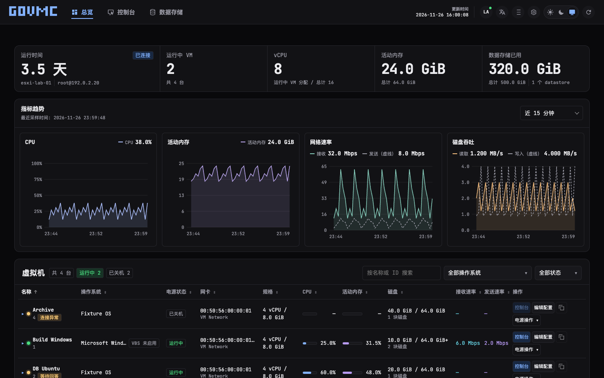
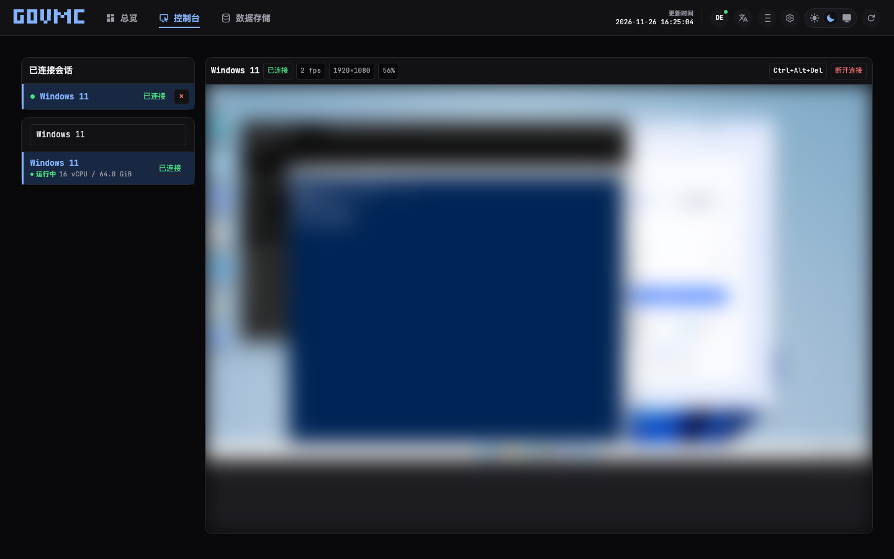
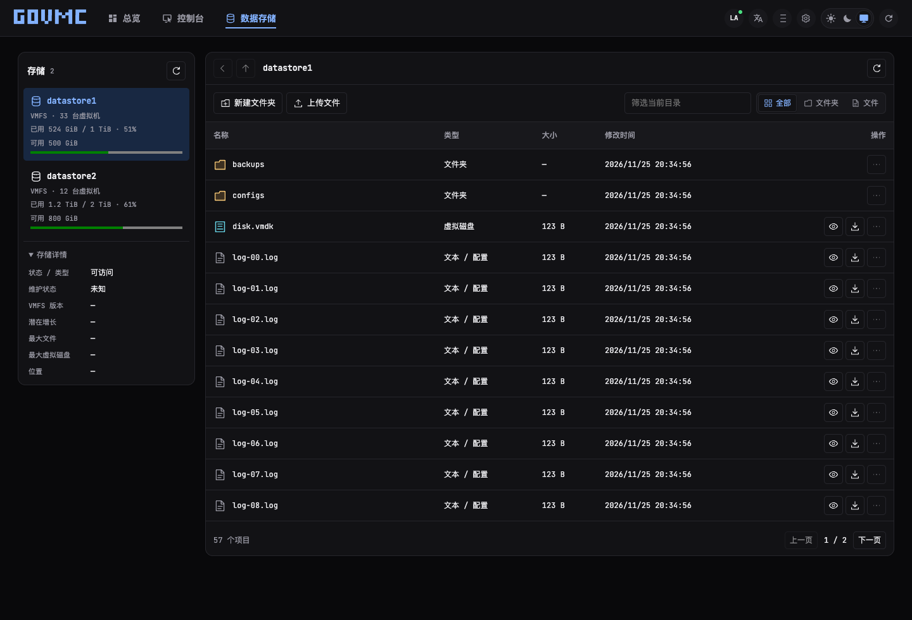
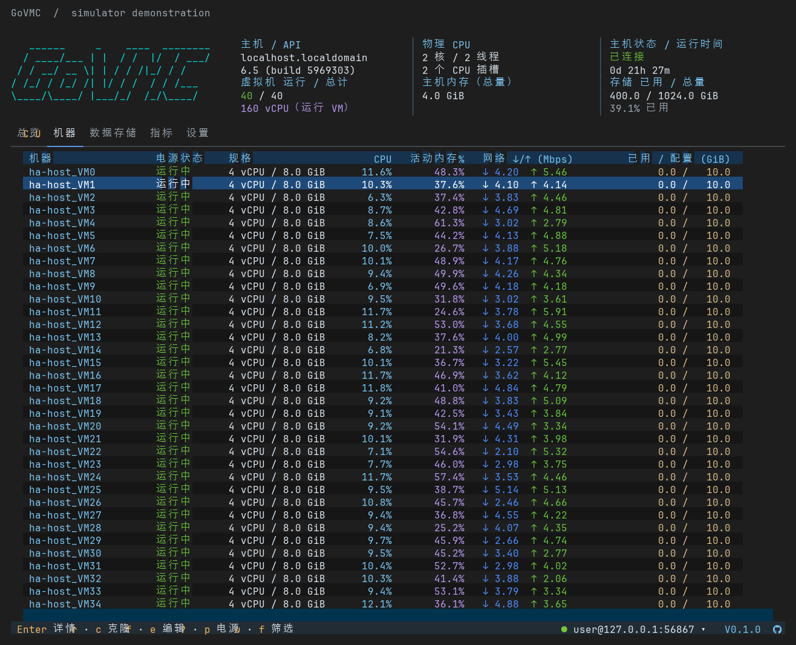
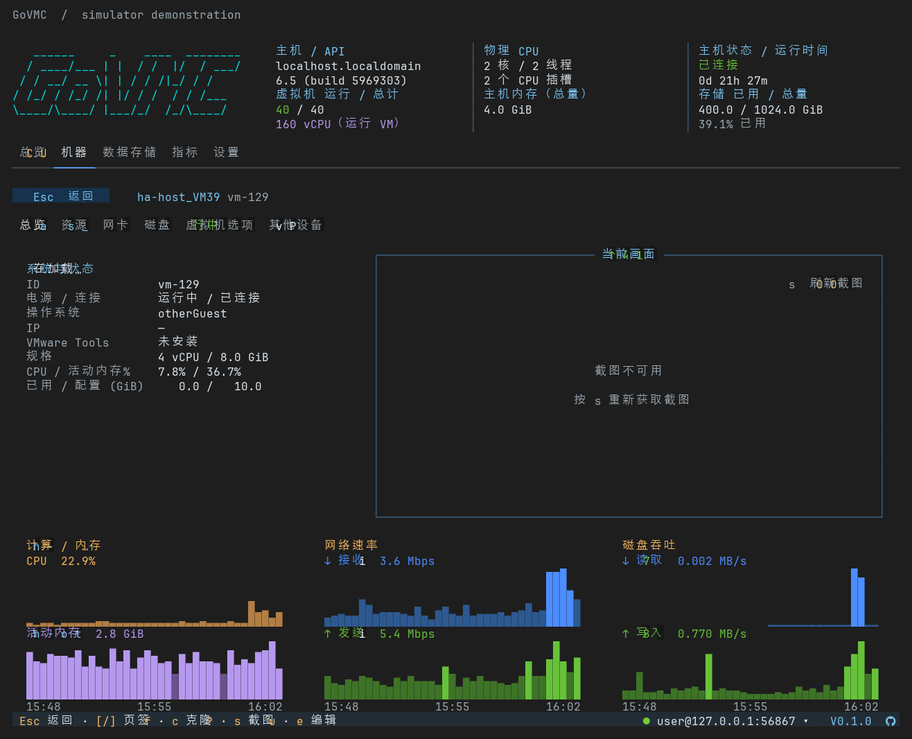
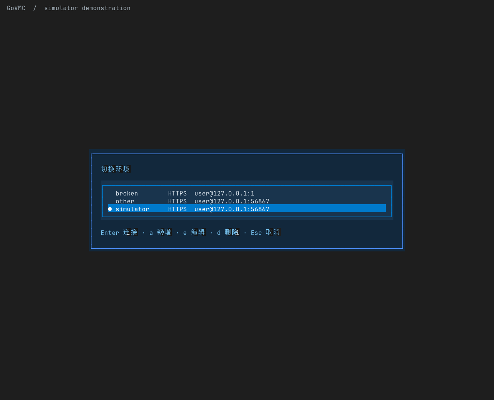

# GoVMC

[English](README.md) | **简体中文**

[](https://go.dev/)
[](https://github.com/Necho-dev/govmc-cli/actions/workflows/test.yml)
[](https://github.com/Necho-dev/govmc-cli/releases)
[](https://pypi.org/project/govmc-cli/)
[](LICENSE)
[](https://github.com/Necho-dev/govmc-cli)

基于 Go 的 ESXi 管理工具，提供原生 **CLI**、全屏 **TUI**、**stdio MCP** 和 **Web 工作台**。各入口共用设备服务、配置、任务历史和操作审计。可执行命令为 `govmc`，Go 模块为 `github.com/Necho-dev/govmc-cli`，Python 分发包同样名为 `govmc-cli`。

独立 ESXi 是主要验收目标。vCenter 路径仍受默认数据中心／主机选择约束，目前不等同于完整的 vCenter 编排产品。

<p align="center">
  
</p>

<table>
  <tr>
    <td align="center" valign="top" width="33%"><strong>Web · 总览</strong><br></td>
    <td align="center" valign="top" width="33%"><strong>Web · 控制台</strong><br></td>
    <td align="center" valign="top" width="33%"><strong>Web · 数据存储</strong><br></td>
  </tr>
  <tr>
    <td align="center" valign="top" width="33%"><strong>TUI · 机器</strong><br></td>
    <td align="center" valign="top" width="33%"><strong>TUI · 详情</strong><br></td>
    <td align="center" valign="top" width="33%"><strong>TUI · 环境</strong><br></td>
  </tr>
</table>

动图演示 CLI 命令，截图展示 Web 与终端工作台。公开素材不含凭据和真实环境地址；WMKS SDK 单独安装，不随仓库分发。

## 功能

- **机器与指标**：主机／虚拟机清单、电源操作、硬件详情、截图，以及 CPU、内存、网络和磁盘吞吐采样。
- **配置编辑**：CLI/TUI/Web 支持 CPU／内存、部分虚拟机选项、磁盘扩容／添加和网卡编辑／添加。在线变更取决于主机、控制器、快照和热添加设置；磁盘只能增大。
- **克隆与文件传输**：预览、确认、同主机跨 datastore 目标、持久化任务、进度和取消请求，覆盖 CLI/TUI/Web/MCP。
- **环境管理**：加密保存凭据、临时指定目标；重命名后仍可查询历史任务、日志与审计。
- **Agent 接入**：统一 stdio MCP，默认只读权限、结构化 JSON，以及兼容 CLI/MCP 的离线内置 Skill。
- **Web 工作台**：机器总览、交互控制台、存储浏览器、任务抽屉、设置、五种外观选项，以及按环境隔离的 IndexedDB 缓存。
- **本地可观测性**：易读的终端日志、保留原始字段的 JSONL、SQLite 审计和按环境查询。
- **共用翻译**：CLI/TUI/Web 共用 `web/locales/` 下按语言拆分的 JSON 词典。

## 快速开始

从当前仓库构建，要求 Go 1.25 或更高版本：

```sh
make build
./bin/govmc --help
./bin/govmc profiles add lab --url https://esxi.example:443/sdk --username root
./bin/govmc profiles use lab
./bin/govmc doctor
./bin/govmc vm list --json
./bin/govmc --profile lab tui
```

创建环境时会隐藏输入密码。新环境默认验证 TLS；确有需要时显式使用 `--insecure`。下文命令假设 `govmc` 已在 `PATH` 中，使用 `make install` 可通过 Go 安装。

## 安装与分发

项目仓库和 PyPI 包名均为 **`govmc-cli`**，安装后的命令为 **`govmc`**。首个版本为 `0.1.0`，可按下列方式从 PyPI、GitHub 发布制品安装，或从源码构建。

### Python：pipx 或 pip

需要 **Python 3.9+** 和对应平台的 wheel。wheel 内含 Go 可执行文件，安装时**不需要 Go 编译器**。

```sh
# 推荐使用 pipx 隔离安装 CLI：
pipx install govmc-cli

# 或安装到 Python 虚拟环境：
python3 -m venv .venv
# macOS / Linux：
. .venv/bin/activate
# Windows PowerShell 使用：.venv\Scripts\Activate.ps1
python -m pip install --upgrade pip
python -m pip install govmc-cli
govmc --version
```

指定版本：`python -m pip install govmc-cli==0.1.0`。升级：`pipx upgrade govmc-cli` 或 `python -m pip install --upgrade govmc-cli`。

### Go：安装或构建

编译需要 **Go 1.25+**。也可以从 [GitHub Releases](https://github.com/Necho-dev/govmc-cli/releases) 下载对应平台 ZIP，解压后将 `govmc`（Windows 为 `govmc.exe`）加入 `PATH`，运行时不需要 Go 或 Python。

```sh
# 将已发布版本安装到 $(go env GOPATH)/bin：
go install github.com/Necho-dev/govmc-cli/cmd/govmc@v0.1.0
# 或安装最新已发布版本：
go install github.com/Necho-dev/govmc-cli/cmd/govmc@latest

# 从源码构建：
git clone https://github.com/Necho-dev/govmc-cli.git
cd govmc-cli
make build
./bin/govmc --version
# 安装当前源码：make install
```

若找不到 `govmc` 命令，将 `$(go env GOPATH)/bin`（或配置的 `GOBIN`）加入 `PATH`。源码构建只需要 Go；额外制作 ZIP／wheel 制品时，构建辅助脚本才需要 Python。

### 两种安装方式使用相同命令

```sh
govmc profiles add lab --url https://esxi.example:443/sdk --username root
govmc profiles use lab
govmc doctor
govmc vm list
govmc tui
govmc serve --listen 127.0.0.1:8765
# 配置 Agent 使用的内置 Skill：
govmc skill install --client codex
```

创建 Profile 时会隐藏输入密码并自动加密保存。普通 Web 随程序提供，只有浏览器交互控制台需要另行安装官方 WMKS SDK；无需安装 `[web]` extra。

### 未安装 WMKS 的完整 Web 配置

`serve` 仍需要有效且可连接的 ESXi 环境。只有浏览器交互控制台依赖 SDK；总览、指标、截图、配置、存储、任务及 CLI/MCP/TUI 均不依赖它。新安装不要求 `.env` 文件。

```sh
# 只需创建一次环境，密码隐藏输入并加密保存。
govmc profiles add lab --url https://esxi.example:443/sdk --username root
govmc profiles use lab
govmc --profile lab doctor --json

# 全新配置应显示 state=missing，这不会阻止普通 Web。
govmc wmks status --json
govmc --profile lab serve --listen 127.0.0.1:8765
```

访问 <http://127.0.0.1:8765>。控制台导航保留，显示安装指引，不申请票据。默认校验 TLS；确有需要时才针对 ESXi 证书显式使用 `--insecure`。

### WMKS 安装、生效、修复与卸载

从 [HTML Console SDK 官方页面](https://developer.broadcom.com/sdks/vmware-html-console-sdk/latest/) 获取你有权使用的 SDK ZIP，页面目前列出 2.2.1。GoVMC 不自动下载、不代为接受条款，也不验证发布者身份。ZIP 与文件的 SHA-256 用于检测内容变化，不等同厂商认证。

官网下载步骤：

1. 打开 [VMware HTML Console SDK](https://developer.broadcom.com/sdks/vmware-html-console-sdk/latest/)，在 **Downloads** 中下载 `WebMKS_SDK_2.2.1.zip`。官网生成临时签名下载地址，建议通过页面按钮下载。
2. 保留原始 ZIP，无需解压、移动文件或重新打包；把它放到运行 `serve` 的主机上。
3. 下载后核对摘要。当前实测官方包 SHA-256 为 `fa0e8b0cf8f41a3c8d03626d848ab372e1b5e1177066add7124547095c278746`。macOS 可运行 `shasum -a 256 ~/Downloads/WebMKS_SDK_2.2.1.zip`，Linux 使用 `sha256sum`，PowerShell 使用 `Get-FileHash -Algorithm SHA256`。后续官方包变化时重新核对来源，不将此摘要用于其他版本。

默认配置安装到 `~/.govmc/wmks/`。若 YAML 设置了 `wmks.directory`，则使用该目录；选择自定义配置时，安装和启动都要带相同的 `--config`。`--wmks` 仅覆盖 serve 的本次启动，不修改安装位置。

在**运行 serve 的主机上**另开终端，使用同一用户和配置目录：

```sh
govmc wmks install --file ~/Downloads/WebMKS_SDK_2.2.1.zip --dry-run --json
govmc wmks install --file ~/Downloads/WebMKS_SDK_2.2.1.zip --yes
govmc wmks status --json
govmc wmks verify --json
```

先查看预览再提交。交互终端可省略 `--yes`，预览后确认；非交互变更必须明确指定。安装／更新可在 serve 运行时进行，但旧进程继续使用旧快照。CLI `state=ready` 表示磁盘组件就绪，不表示所有运行进程均已采用它。

通过 Ctrl+C 停止旧 serve，以**相同**环境／配置重启，然后刷新页面或点击“重新检测”：

```sh
govmc --profile lab serve --listen 127.0.0.1:8765
```

组件可用后选择开机的机器，先初始化画布，再申请票据；仍要求 ESXi 权限和 WSS 可达。组件加载失败与 ESXi 登录／出票失败分开提示。重启 serve 会断开 Web 会话，虚拟机会继续运行。

卸载前，先停止正在使用当前 SDK 的 serve：

```sh
govmc wmks uninstall --yes
govmc wmks status --json
# 再次启动：普通 Web 可用，控制台恢复安装指引。
govmc --profile lab serve --listen 127.0.0.1:8765
```

`wmks_in_use` 表示仍有进程持有当前组件。未安装或损坏时，`verify` 返回非零退出码；未安装时 `status` 成功返回 `missing`，状态无效时则报告错误。校验失败可按“停止相关 serve → 卸载 → 安装有效 ZIP → 校验 → 重启”恢复。同一内容不会覆盖损坏的不可变目录，需要先卸载。状态元数据损坏时先保留现场排查，不要修改加密的 Profile 数据。

Web 会话与刷新：有活动会话时，从控制台切到总览（包括 Logo、窄屏菜单、浏览器前进／后退）需要确认，确认后连接保留在后台；取消保持当前画面。刷新或关闭页面会显示浏览器原生提示，跳转到设置／存储等页面时显示全页确认。虚拟机不会因离页而关机。当前标签页按服务实例与环境在 sessionStorage 中仅记住机器标识和选中项（最多 6 台、有效 12 小时）；刷新或返回后，根据新清单核对机器身份并重新取票恢复画面，不保存票据，也不自动接管键鼠。手动断开的会话、关机／移除／身份变化的机器不会自动重连；环境切换清除旧环境的恢复记录。浏览器可能要求先发生用户交互才显示原生刷新提示，提示文字和样式由浏览器决定。顶栏刷新按钮只更新数据，不会重建远控连接。

### SDK ZIP 的目录与限制

ZIP 中必须恰好只有**一份**名为 `wmks.min.js` 的文件。以下四个路径必须相对同一 SDK 根目录存在、**非空且大小写一致**：

```text
SDK.zip
└── optional/outer/directory/
    ├── wmks.min.js
    ├── css/wmks-all.css
    └── img/
        ├── touch_sprite.png
        └── touch_sprite_feedback.png
```

也支持文件直接位于 ZIP 根目录。示例／备份目录里若又包含一份同名文件，会因根目录歧义被拒绝。应保留上游全部许可证／声明文件。不要求 GoVMC `plugin.json`、GoVMC 源码／二进制、wheel 或另打包的 jQuery。文件名／扩展名不决定是否有效：内容必须是符合结构的 ZIP，不能只传单个 JS，也不能只在 ZIP 中再套一个未展开的 ZIP。

| 校验项 | 要求 |
| --- | --- |
| ZIP 本身 | 不超过 32 MiB |
| 单文件解压大小 | 不超过 16 MiB |
| 实际累计解压大小 | 不超过 128 MiB，包含最终不安装的文件 |
| 条目总数 | 文件和显式目录条目合计不超过 1,024 |
| 路径 | 相对路径，最多 512 字节；拒绝 `..`、绝对路径、盘符／UNC、反斜杠、控制字符、Windows 保留名及尾随点／空格 |
| 重名与类型 | 拒绝仅大小写不同的重名、符号链接和特殊文件 |
| 编码 | 未加密 ZIP，使用 Go ZIP 读取器支持的方法（常见 Store／Deflate）；不支持密码／加密 |

安装保留 `wmks.min.js`、`css/`、`img/`，以及文件名包含 `license` 或 `notice` 的声明；不执行包内程序。JavaScript 标识检查和文件摘要只说明结构／内容完整性，**不保证 SDK、浏览器、ESXi 兼容性**。无法核实的 SDK 版本显示 `unidentified`，仍需在浏览器完成实际初始化。


官方包实测：从[官网下载区](https://developer.broadcom.com/sdks/vmware-html-console-sdk/latest/)取得的 `WebMKS_SDK_2.2.1.zip`（378,058 字节），已在独立配置下通过预览、安装、校验、状态查询及卸载。MD5 与官网公布的 `b3d69d9422fb3725d96d322c6c29bd16` 一致；SHA-256 为 `fa0e8b0cf8f41a3c8d03626d848ab372e1b5e1177066add7124547095c278746`。下载地址由网站动态生成，请使用 Download 按钮，不保存临时签名链接。已验证官方包安装及真实 ESXi Web 控制台画面与键鼠操作；部署后仍需验收自己的 ESXi／浏览器组合。

### 配置和运行目录

```text
~/.govmc/
  config.yaml                    # CLI/TUI 生成的环境与偏好
  config.key                     # 凭据密钥，随配置一起保管
  data.db                        # 任务与审计
  logs/                          # 运行 JSONL
  wmks/
    state.json                   # 当前 SDK 摘要，不含 Profile 密码
    sdk/<content-digest>/        # 运行资源、声明与 receipt.json
    .locks/                      # 安装与使用中锁
```

SDK 目录统一在 `config.yaml` 中设置：

```yaml
wmks:
  directory: ./wmks
```

相对路径以配置文件所在目录为基准；省略时默认使用该目录下的 `wmks/`。CLI/TUI/MCP/serve 共用这份配置，无需设置环境变量。

临时覆盖仅影响本次启动，不修改 YAML：

```sh
govmc serve --wmks /path/to/sdk
```

优先级：`--wmks` → `wmks.directory` → 默认目录。`--wmks` 的相对路径以当前工作目录为基准，支持已安装目录或解压后直接含 `wmks.min.js`、`css/`、`img/` 的目录。解压目录只读加载；校验失败仅禁用浏览器控制台，普通 Web 仍可使用。托管目录的安装、校验、卸载请使用 YAML 配置对应的 `govmc wmks` 命令。

SDK 对该配置目录全局生效，`--profile` 只选 ESXi，不决定另一套 SDK。除非浏览器客户端也运行 serve，否则不应在客户端电脑安装。显式选择配置时，所有命令必须保持一致：

```sh
govmc --config /srv/govmc/config.yaml profiles add lab --url https://esxi.example:443/sdk --username root
govmc --config /srv/govmc/config.yaml wmks install --file /path/to/SDK.zip --yes
govmc --config /srv/govmc/config.yaml wmks verify --json
govmc --config /srv/govmc/config.yaml --profile lab serve --listen 127.0.0.1:8765
```

示例目录 `/srv/govmc` 需要运行 serve 的用户可读写，可改为合适的本机目录。PowerShell 同样使用 `--config` 参数。普通使用无需覆盖。不要手工向 YAML 填写密码或 SDK 内容。卸载只删除当前 SDK 摘要目录，旧更新缓存不会自动启用或清理。排障方法详见[内置 WMKS 参考](skills/esxi-govc/references/web_console.md)。


## 环境与凭据

默认配置为 `~/.govmc/config.yaml`，可通过 `--config /path/config.yaml` 选择其他文件。日常使用不要求环境变量或 `.env` 文件。

```sh
govmc profiles list
govmc profiles current
govmc profiles update lab
govmc profiles rename lab staging
govmc profiles use staging
govmc --profile production vm list --json
```

`--profile` 只覆盖本次命令，不修改默认环境。CLI/TUI 支持新增、编辑、重命名和删除环境，破坏性环境变更需要确认。TUI 表单提供“仅保存”和“保存并连接”。Web 只支持切换已保存环境，切换前确认，各浏览器页签独立选择；不支持新增、编辑或删除环境。

私有文件在 Unix 使用 `0600` 权限，在 Windows 使用仅允许当前用户、SYSTEM 和管理员访问的受保护 ACL。密码使用 AES-256-GCM 加密，独立密钥 `config.key` 位于配置文件同目录，两者均采用上述平台对应的访问限制。备份时需要同时保管两者。这可防止仅配置文件泄露时直接读取密码，不能抵御同时读取配置与密钥或拥有本机用户权限的攻击者。自动化通过 `--password-stdin` 对接已有凭据管理器，不在命令参数中填写密码。`profiles list/show/current` 不输出凭据。

Profile 具有稳定标识。通过 `profiles rename OLD NEW` 或 TUI 改名后，在新名称下即可查询过去的任务／日志／审计。详情保留 `originalProfile`；原始记录和 JSONL 不改写。将旧名用于另一个环境时，不会混入前一个环境的历史。

旧 `govmc/profiles.json` 配置可在首次使用时迁移，缺失的旧凭据需要重新保存。兼容环境变量覆盖仍保留，新配置建议统一使用 Profile。

## 命令概览

| 用途 | CLI 入口 |
| --- | --- |
| 连接检查 | `govmc doctor` |
| 主机／机器 | `govmc host info`、`govmc vm list`、`govmc vm info VM` |
| 指标 | `govmc metrics counters`、`govmc metrics host`、`govmc metrics vm VM` |
| 硬件配置 | `govmc vm edit VM --file changes.json` |
| 截图 | `govmc vm screenshot VM --out /tmp/screenshot.png` |
| 控制台输入 | `govmc vm console input VM --actions actions.json --dry-run` |
| 存储／浏览 | `govmc datastore list`、`govmc datastore files DATASTORE PATH` |
| 持久化任务 | `govmc tasks list`、`govmc tasks status TASK_ID`、`govmc tasks cancel TASK_ID` |
| 运行日志／审计 | `govmc logs`、`govmc audits` |

完整参数以各命令 `--help` 为准，`--json` 输出结构化结果。虚拟机配置支持 JSON 文件或 `--file -`，字段和在线变更限制见 [Skill 使用参考](skills/esxi-govc/references/usage.md)。

### 克隆与文件传输

```sh
# 仅预览，不创建执行任务，也不修改资源。
govmc --profile lab vm clone BASE CHILD --dst-datastore datastore2 --dry-run --json
govmc --profile lab datastore copy datastore1 source.iso copies/source.iso --dst-datastore datastore2 --dry-run --json

# 检查计划后提交；--yes 表示明确确认。
govmc --profile lab vm clone BASE CHILD --dst-datastore datastore2 --yes --json
govmc --profile lab tasks list --json
govmc --profile lab tasks status TASK_ID --watch --timeout 10m
```

母机必须关机且连接正常。默认继承支持的母机硬件配置及磁盘置备类型，生成新的虚拟机身份，克隆后保持关机。客户机主机名、固定 IP 和应用 ID 仍需另外定制。不支持的磁盘／快照／加密／vTPM 组合在预检时拒绝，不静默生成不完整副本。

`datastore move` 与 `copy` 使用相同预览／确认流程。跨 datastore 操作限于同一 ESXi 环境，不提供跨主机／Profile 迁移。克隆、复制、移动会在 `data.db` 创建持久化任务，普通查询和 dry-run 不创建执行任务。四端使用同一配置目录时查询同一份任务库。取消是请求，不代表回滚；进程中断后不会自动重放流程。详见[内置克隆工作流](skills/esxi-govc/references/clone_workflow.md)。

### 远程控制

CLI 和 stdio MCP 自动获取 WebMKS 票据并直连 ESXi，无需先运行 `serve`。`vm console input` 支持受限的键盘、鼠标和等待动作，`--dry-run` 不发送输入。MCP 提供 `esxi_vm_console_input`、`esxi_vm_console_press_key`、`esxi_vm_console_type_text` 和 `esxi_vm_console_pointer`。

输入不依赖 VMware Tools，但受客户机焦点和键盘布局影响。发送成功不等于客户机程序执行成功，需要重新截图验收。Web 提供交互键鼠控制台；TUI 当前提供截图，不提供交互控制台。GuestOperations 执行是另一个依赖 Tools 的 MCP/REST 能力。详见[远程控制](skills/esxi-govc/references/remote_control.md)。

## TUI

底栏对齐 OpenWrt CLI：`V0.1.1` 与 GitHub 链接，点击图标或按 `G` 打开项目。GitHub 字形使用 Nerd Font 显示。

```sh
govmc --profile lab --language zh tui
```

主模块为 **Overview / Machines / Datastores / Metrics / Settings**。选中机器后按 `Enter` 进入详情，`Esc` 返回时保留搜索、筛选和选中位置。`e` 编辑、`p` 电源操作、`c` 克隆关机母机。详情同时展示紧凑的基础信息、截图和指标图表。

Settings 包含 **Language / MCP / Profiles / Tasks / Logs / Audits**，通过 `[` / `]` 切换子页，按界面提示筛选、刷新和操作。存储浏览区分目录与文件，返回父目录时保留上下文，复制／移动先预览再确认。

## Web 工作台

```sh
# 普通 Web 已内置，控制台 SDK 可选：
govmc --profile lab serve --listen 127.0.0.1:8765
# 显式监听局域网，其他设备使用服务器实际 LAN IP 访问：
govmc --profile lab serve --listen 0.0.0.0:8765
```

默认地址为 <http://127.0.0.1:8765>，启动时会打印访问地址。`--web-dir` 指向静态资源，不决定 Profile 或数据存放位置。普通页面默认内嵌；`--web-dir` 仅用于显式覆盖为匹配的 UI 资源，不用于安装 SDK。

总览、控制台和数据存储共用顶部导航与环境选择器。任务抽屉支持状态筛选、详情／返回、进行中任务角标、手动刷新和可关闭的自动刷新。设置页提供外观／语言、运行日志和操作审计。魔法蓝和经典深色在设置中选择，右上角保留浅色／深色／跟随系统控制。

总览在可见时自动刷新，通常间隔 20 秒；指标时间表示 ESXi 采样时间，不是模拟的实时时钟。后台页签暂停轮询，返回时刷新。请求期间优先展示 IndexedDB 缓存快照，缓存数据不能用于放行写操作。

本地 `serve` 当前**没有登录页或基于 Cookie 的账号认证**。保留可选 `API_TOKEN` 访问控制，MCP mode 不限制 Web/REST 操作。监听 `0.0.0.0` 后，可达客户端将在所配置的访问控制下访问这些环境。Docker 登录、邀请码和账号存储尚未实现。

## MCP 与内置 Skill

```sh
govmc mcp json --client codex
govmc mcp serve
govmc mcp privilege --json
govmc skill show
govmc skill install --client codex
```

MCP **只保留 stdio**，由客户端以子进程启动 `govmc mcp serve`，stdout 仅承载 JSON-RPC。旧 HTTP `/mcp` 及 `--mcp-stdio` 入口已移除，REST 接口继续保留。

默认权限为 `readonly`，仅 CLI/TUI 可修改，Web/MCP 不能提升权限。每次调用重读配置，全局权限为上限，Profile 可进一步收紧：

```sh
govmc config set --mcp-mode readwrite
govmc profiles update production --mcp-mode readonly
govmc profiles update lab --mcp-mode inherit
govmc config set --mcp-mode readonly
```

写操作还需要 `confirm: true`，克隆／复制／移动预览在只读模式下可用。工具的单次 `profile` 参数优先于进程默认环境，不修改 `active`；`govmc --profile lab mcp serve` 只固定默认目标。本地任务／日志／审计查询不要求连接 ESXi。工具并非与所有 CLI 命令逐项等同，例如配置编辑目前由 CLI/TUI/Web 提供，没有通用 MCP 编辑工具。

内置 `esxi-govc` Skill 可离线安装，兼容 CLI 和 stdio MCP，说明选择、预览、确认和验收流程；克隆核心由共用 Go 编排实现，并非只能依赖 Skill 脚本。CLI/MCP 操作流程见 [Skill](skills/esxi-govc/SKILL.md)。REST 契约通过 `GET /v1/openapi.yaml` 查询，源码见 [openapi.yaml](internal/httpserver/openapi.yaml)。

## 日志、审计与语言

所有本地状态跟随所选配置文件所在目录：

| 文件／目录 | 用途 |
| --- | --- |
| `config.yaml` / `config.key` | 环境、偏好、权限／凭据加密密钥 |
| `data.db` | SQLite 操作审计与持久化任务 |
| `logs/` | 分进程原始结构化 JSONL 运行日志 |

终端日志使用完整时间和易读文本，交互终端提供少量颜色；JSONL 保留原始结构化字段。运行日志默认保留 7 天、50 MiB 清理目标，审计默认保留 90 天。仅记录白名单元数据，不保存密码、Token 或请求／响应正文。审计不具备抵御本机管理员篡改的能力。

```sh
govmc logs --target lab --source serve --limit 50 --json
govmc audits --target lab --outcome failed --limit 50 --json
govmc config language zh
govmc --language en tui
```

TUI/Web 设置和 MCP `esxi_logs_list` / `esxi_audits_list` 查询相同数据源。翻译源为 `web/locales/en.json` 和 `zh.json`，Go 内嵌、Web 加载；浏览器外观／语言选择作为本地偏好保存。

## 开发与发布

```text
cmd/govmc/           Go 可执行程序入口
internal/command/    Cobra 命令组合与启动入口
internal/tui/        终端工作台、表单、布局及交互测试
internal/i18n/       Go 共用翻译助手，词典位于 web/locales
internal/profile/    Profile 稳定身份与改名历史
internal/            ESXi、REST、stdio MCP、编排、任务与日志存储
web/                 普通 Web、共用词典与内嵌资源
skills/              内置离线 Skill 与操作参考
build/               原生发布与可选 Python wheel 构建辅助
tests/               浏览器和打包回归测试
assets/              README 公共截图和模拟演示动图
.github/workflows/   日常检查与标签自动发布
```

```sh
make test
make check
# 基于模拟器的 CLI/TUI/Web/stdio 集成覆盖与竞态检测：
GOVMC_TUI_SIM_TEST=1 GOVMC_WEB_SIM_TEST=1 GOVMC_SERVE_BINARY="$PWD/bin/govmc" go test -race -count=1 ./...
go test -tags webassets ./...
make web-smoke

# 在本地构建当前开发版本：
make release VERSION=0.1.1
make wheel VERSION=0.1.1
```

依赖二进制的集成测试前先构建当前代码。Web smoke 通过 `npx` 使用 Chrome 和 `@playwright/cli`，覆盖工作台、存储、设置、主题、任务抽屉和缓存，使用固定测试数据，不替代真实 ESXi 验收。

发布流程对齐 openwrt-cli：推送 `vX.Y.Z` 或 `vX.Y.ZrcN` 标签后，自动运行测试，检查双语 CHANGELOG 的对应版本记录，并确认 PyPI 尚未发布该版本；随后构建 Linux/macOS amd64/arm64、Windows amd64 的原生 ZIP、校验和与 wheel，发布 PyPI，再创建 GitHub Release。普通分支推送和 PR 只运行检查。正式版本由标签注入 Go 二进制，首版为 `0.1.0`。

首次发布前，先到 [GitHub Settings → Environments](https://github.com/Necho-dev/govmc-cli/settings/environments) 创建名称严格为 `pypi` 的环境，再在 PyPI 配置对应仓库、工作流 `publish.yml`、environment `pypi` 的 Trusted Publisher（[官方说明](https://docs.pypi.org/trusted-publishers/using-a-publisher/)），若编辑器提示 `Value 'pypi' is not valid`，检查新仓库是否已有此环境，再刷新／重载 GitHub Actions 扩展；`pypi` 本身是合法的工作流环境名。无需配置 PyPI API Token。制品不携带 VMware WMKS。Linux arm64、macOS amd64 使用交叉编译；Linux amd64、macOS arm64、Windows amd64 在对应 runner 上验证原生程序与 wheel 的运行及安装流程。

复用原生制品可运行 `python3 build/wheel.py --version VERSION --binary dist/govmc`（Windows 使用 `dist/govmc.exe`），版本与平台应保持一致。构建辅助脚本只使用 Python 标准库，产品本身仍是 Go 可执行程序。wheel 使用完整英文 README 作为 PyPI 项目介绍，其中图片和文档的相对链接会转换为指向对应发行标签的完整地址。

## 鸣谢

- [VMware govmomi](https://github.com/vmware/govmomi)：GoVMC 直接使用的 Go vSphere SDK，提供 API 客户端及 `vcsim` 模拟器。同一上游项目也提供 [govc CLI](https://github.com/vmware/govmomi/tree/main/govc)；运行 GoVMC 无需额外安装 `govc` 可执行程序。
- [VMware HTML Console SDK（WMKS）](https://developer.broadcom.com/sdks/vmware-html-console-sdk/latest/)：为可选的浏览器交互控制台提供支持。SDK 需由用户按上游条款单独获取、安装，不包含在本项目开源仓库、原生发布包或 Python wheel 中；仓库只提供加载适配代码和安装说明。
- [OpenWrt CLI](https://github.com/Necho-dev/openwrt-cli)：终端工作台、环境管理、MCP 权限模式、README 展示与发布流程的设计参考。
- [tview](https://github.com/rivo/tview)／[tcell](https://github.com/gdamore/tcell)：终端界面、输入与绘制；[JetBrains Mono](https://github.com/JetBrains/JetBrainsMono)：界面字体。

## 许可证与开源边界

GoVMC 项目代码采用 [MIT 许可证](LICENSE)，与 OpenWrt CLI 的许可证选择一致；版权声明为 © 2026 govmc-cli contributors。第三方组件继续遵循各自许可：`govmomi` 为 Apache-2.0，jQuery／jQuery UI 为 MIT，JetBrains Mono 为 SIL OFL 1.1，现有第三方版权和许可声明予以保留。原生 ZIP 与 Python wheel 均附带项目 LICENSE。

VMware HTML Console SDK 是可选外部依赖，不包含在源码、原生发布包或 Python wheel 中。请从官方来源取得并通过 `govmc wmks install` 单独安装；安装操作不改变上游许可条款。
